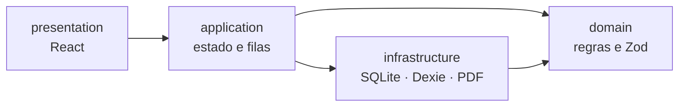

# Francisco Gomes

**Software para o setor automóvel, feito para funcionar onde o trabalho acontece.**

Estudante de Engenharia Informática no ISEP · Porto, Portugal

   

[Kota](#kota) · [Rasto](#rasto) · [Como trabalho](#como-trabalho) · [Stack](#stack) · [Contacto](#contacto)

---

## Projetos

Oficinas e stands trabalham de luvas calçadas, com rede fraca e sem tempo para formulários. Construo ferramentas que abrem depressa, guardam tudo no dispositivo e produzem documentos prontos a entregar ao cliente.

| | Projeto | Para quem | Estado |
| :-: | --- | --- | --- |
| 🔧 | [**Kota**](#kota): orçamentos de reparação em PDF | Oficinas | Disponível em Android e Windows |
| 🚗 | [**Rasto**](#rasto): cada viatura, com tudo registado | Pequenos stands | Piloto online |

---

## Kota

> **Orçamentos de reparação para oficinas, no telemóvel e no computador, sem internet.**

O Kota cria orçamentos em PDF A4 com totais exatos, numeração sequencial e a marca da oficina. Os dados ficam cifrados no próprio dispositivo: sem conta, sem nuvem, sem anúncios.

 

### O que faz

| | |
| --- | --- |
| **100% offline** | Funciona sem rede. Orçamentos e clientes nunca saem do dispositivo. |
| **PDF A4 profissional** | Cabeçalho com a marca da oficina, peças, mão de obra, IVA e total. |
| **Rápido no telemóvel** | Pensado para usar junto da viatura, com envio por WhatsApp em poucos toques. |
| **Dados cifrados** | SQLCipher com chave no Android Keystore; DPAPI no Windows; cópias `.kota` em AES-256-GCM. |
| **Android e Windows** | A mesma aplicação em todos os dispositivos. |
| **Licença anual** | MB WAY, Multibanco ou cartão. Sem renovação automática. |

### Engenharia

- **Aritmética financeira exata.** Montantes em cêntimos inteiros, quantidades em centésimos, percentagens em pontos-base, cálculos intermédios em `BigInt` com arredondamento *half-up*. Os totais são sempre derivados, nunca importados.
- **Camadas puras.** O domínio não conhece React, bases de dados nem PDF. Os efeitos secundários vivem isolados na infraestrutura.
- **Persistência transacional.** Contadores sequenciais atómicos e relógio de revisões (*CAS*) que impede sobrescrever versões mais recentes.
- **Privacidade por desenho.** Sem telemetria nem análise de tráfego. A única ligação à rede é o licenciamento, só após um clique explícito do utilizador, e nunca envia dados de clientes ou orçamentos.
- **Portão de qualidade antes de cada commit.** Testes unitários com cobertura de linhas ≥ 95%, build estrito, suite E2E em Playwright (390 px e 1440 px, teclado e movimento reduzido), verificação visual dos PDFs e auditoria de dependências.

### Descarregar e instalar

Cada versão inclui o instalador para todos os dispositivos na [página de versões](https://github.com/Francisss9/Portfolio/releases?q=kota):

- **Android 10+:** `Kota-X.Y.Z.apk`. Descarregue, permita a instalação a partir de fontes desconhecidas quando o Android perguntar e toque em **Instalar**. Se já tem o Kota, instala-se por cima e os dados mantêm-se.
- **Windows (x64, portátil):** `Kota-X.Y.Z-x64.exe`. Sem instalação: guarde numa pasta e abra.

Cada versão traz um `SHA256SUMS` para confirmar a integridade do ficheiro. Para emitir PDF é necessária uma licença, ativada em **Definições → Licença**. Há uma experiência gratuita de 7 dias, por pedido.

---

## Rasto

> **Cada viatura, com tudo registado.**

Gestão para pequenos stands: viaturas, custos, pós-venda, importação de Excel e relatórios PDF com as secções que escolher. Funciona em modo local ou como piloto online.

 

- **Ficha completa por viatura**, com custos e histórico de pós-venda.
- **Importação de Excel** para passar do ficheiro antigo ao sistema sem reescrever nada.
- **Relatórios PDF** com secções selecionáveis, prontos a partilhar.
- **Acesso controlado**: o piloto online só admite contas autorizadas pelo responsável do stand.

---

## Como trabalho

- **Primeiro o problema real.** Falo com quem usa a ferramenta e desenho à volta do dia a dia: uma mão ocupada, rede instável, o cliente à espera.
- **Dados do utilizador pertencem ao utilizador.** Offline por defeito, cifrado, sem contas desnecessárias.
- **Rigor onde o dinheiro passa.** Aritmética inteira, testes sobre cada regra de cálculo, PDFs verificados contra a especificação.
- **Documentar as decisões.** Arquitetura, segurança e design ficam escritos, para que o projeto continue a fazer sentido daqui a um ano.

---

## Stack

           

---

## Contacto

Dúvidas, suporte ou pedido da aplicação: **[suporte@francisgomesx.dev](mailto:suporte@francisgomesx.dev)**

Feito no Porto · Os instaladores e o `SHA256SUMS` de cada versão estão na <a href="https://github.com/Francisss9/Portfolio/releases">página de versões</a>.

