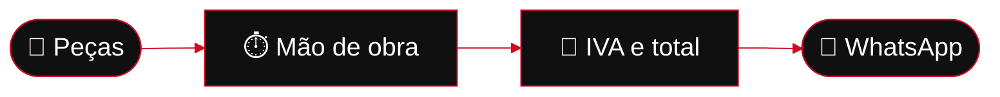
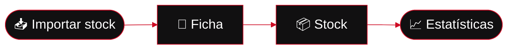

 

**Produtos próprios, feitos de ponta a ponta. Sem complicar.**

 

 

 

**[🔧 Kota](#-kota)** &nbsp;·&nbsp; **[🚗 Rasto](#-rasto)** &nbsp;·&nbsp; **[❓ FAQ](#-perguntas-frequentes)** &nbsp;·&nbsp; **[🧭 Como trabalho](#-como-trabalho)** &nbsp;·&nbsp; **[🛠️ Stack](#%EF%B8%8F-stack)** &nbsp;·&nbsp; **[✉️ Contacto](#%EF%B8%8F-contacto)**

 

## 🏁 Projetos

> [!NOTE]
> Oficinas e stands têm pouco tempo e muita coisa para controlar. Faço software que **poupa trabalho**, **não deixa números fora do sítio** e **dá a cada negócio uma visão clara do que tem**.

<table>
  <tr>
    <td width="50%" valign="top">
      <h3>🔧 Kota</h3>
      
<b>O orçamento certo, ao cêntimo.</b> Para oficinas em Portugal.

      

        
        
        
      

      <a href="#-kota"><b>Ver o Kota →</b></a>
    </td>
    <td width="50%" valign="top">
      <h3>🚗 Rasto</h3>
      
<b>O stock do teu stand, sempre sob controlo.</b> Para stands em Portugal.

      

        
        
      

      <a href="#-rasto"><b>Ver o Rasto →</b></a>
    </td>
  </tr>
</table>

 

---

## 🔧 Kota

> ### O orçamento certo, ao cêntimo.

Faz o orçamento da reparação em poucos minutos, com peças, mão de obra e IVA somados sem erros. Sai em **PDF A4** com a marca da oficina, funciona **sem internet** e os dados da oficina **nunca saem do dispositivo**.

 

<table>
  <tr>
    <td align="center" width="25%"><h3>📴</h3><b>Sem internet</b> Funciona em qualquer oficina</td>
    <td align="center" width="25%"><h3>⚡</h3><b>Rápido</b> Orçamento em poucos minutos</td>
    <td align="center" width="25%"><h3>🔐</h3><b>Privado</b> Sem nuvem, anúncios nem telemetria</td>
    <td align="center" width="25%"><h3>💬</h3><b>WhatsApp</b> Do PDF ao cliente num toque</td>
  </tr>
</table>

 

<b>✨ Tudo o que o Kota faz</b>

 

| | | |
| :-: | --- | --- |
| 📴 | **100% offline** | Orçamentos e clientes nunca saem do dispositivo. |
| 🧮 | **Totais sempre certos** | Valores em cêntimos inteiros e arredondamento correto. O total sai sempre das linhas. |
| 📄 | **PDF A4 profissional** | Marca da oficina, peças, mão de obra, IVA e total. |
| 📱 | **Do telemóvel ao balcão** | Android no bolso, Windows portátil no balcão. |
| 🔐 | **Dados cifrados** | Guardados no teu dispositivo, sem conta nem nuvem. |
| 🖥️ | **Até 3 dispositivos** | Uma licença por oficina, para o telemóvel, o balcão e um tablet. |

<b>🎟️ Licença</b>

 

- **Anual** (12 meses, pagos de uma só vez, sem renovação automática) ou **mensal**.
- Pagamento seguro com **MB WAY, Multibanco ou cartão**, através do Stripe.
- A chave chega logo após o pagamento e ativa-se em **Definições → Licença**.
- **Reembolso** nos primeiros 14 dias, por email.

<b>📥 Descarregar e instalar</b>

 

| | Plataforma | Ficheiro | Como instalar |
| :-: | --- | --- | --- |
| 🤖 | **Android 10+** | `.apk` | Descarrega, permite fontes desconhecidas quando o Android perguntar e toca em **Instalar**. Se já tens o Kota, os teus dados mantêm-se. |
| 🪟 | **Windows 10+ (64 bits, portátil)** | `.exe` | Sem instalação: guarda numa pasta e abre. |

Descarrega no [**site do Kota**](https://kota.francisgomesx.dev) ou na [**página de versões**](https://github.com/Francisss9/Portfolio/releases?q=kota).

> [!TIP]
> Cada versão traz um código de verificação (SHA-256) para confirmares que o download está intacto.

> [!IMPORTANT]
> Para emitir PDF precisas de uma licença, ativada em **Definições → Licença**.

 

---

## 🚗 Rasto

> ### O stock do teu stand, sempre sob controlo.

Todas as viaturas, custos e prazos num só sítio. Vê o que está em stock, o que está parado e o que cada carro te deixa.

 

<table>
  <tr>
    <td align="center" width="25%"><h3>📦</h3><b>Stock num só ecrã</b> Em stock, vendido, investido e garantias a terminar</td>
    <td align="center" width="25%"><h3>🗂️</h3><b>Ficha da viatura</b> Compra, despesas e saldo sempre à mão</td>
    <td align="center" width="25%"><h3>📈</h3><b>O que vende</b> E o que fica parado</td>
    <td align="center" width="25%"><h3>👥</h3><b>Equipa</b> Convites e papéis por pessoa</td>
  </tr>
</table>

 

<b>✨ Tudo o que o Rasto faz</b>

 

| | | |
| :-: | --- | --- |
| 📦 | **Stock à vista** | Filtra por responsável, preparação ou mês de venda. |
| 🗂️ | **Ficha completa** | Valor de venda, compra, despesas e pós-venda, com o saldo antes de impostos. |
| 📈 | **Estatísticas** | Vendas e margem por mês, marcas, stock parado, custos e equipa. Só valores que existem. |
| 📥 | **Importação** | Traz o stock que já tens em Excel, CSV ou JSON, sem voltar a escrever tudo. |
| 📄 | **Relatórios em PDF** | Com o logótipo do teu stand, à tua escolha: resumo do negócio, pós-venda ou ficha completa. |
| 🔑 | **Acesso por conta Google** | Convites para a equipa e papéis: proprietário ou membro. |

<b>🎟️ Planos</b>

 

Sem limite de viaturas em nenhum plano. O plano **Base** já está disponível, o **Pro** abre a 1 de dezembro de 2026, e o **Max** e o **Ultra** estão em desenvolvimento. Preços e detalhes em [**rasto.francisgomesx.dev**](https://rasto.francisgomesx.dev).

> [!NOTE]
> O Rasto precisa de internet. O pagamento online está a ser preparado: até lá, o acesso combina-se por email.

 

---

## ❓ Perguntas frequentes

<b>O Kota funciona sem internet?</b>

 

Sim. Faz e envia orçamentos sem rede. Os dados ficam no teu dispositivo, sem conta nem nuvem.

<b>Quanto custa e como se paga o Kota?</b>

 

Licença anual (paga de uma vez, sem renovação automática) ou mensal, por oficina. Pagas com MB WAY, Multibanco ou cartão. Podes pedir reembolso nos primeiros 14 dias.

<b>Em que dispositivos funciona o Kota?</b>

 

Android 10 ou superior e Windows 10 ou superior (64 bits, versão portátil). Uma licença serve até 3 dispositivos da mesma oficina.

<b>O Rasto funciona sem internet?</b>

 

Não, precisa de ligação à internet.

<b>Posso trazer o meu stock para o Rasto?</b>

 

Sim. Importas o Excel, CSV ou JSON que já tens, ou começas do zero.

<b>Quem pode entrar no Rasto?</b>

 

Entra-se com conta Google, por convite do stand. Cada pessoa tem o seu papel: proprietário ou membro.

 

---

## 🧭 Como trabalho

| | | |
| :-: | --- | --- |
| 🎯 | **Primeiro o problema real** | Falo com quem usa e desenho à volta do dia a dia: mãos ocupadas, stock parado, cliente à espera. |
| 🛡️ | **Os dados são de quem os cria** | Cada oficina e cada stand só vê o que é seu. |
| 🧮 | **Rigor onde o dinheiro passa** | Os totais batem sempre certo e cada regra de cálculo é testada. |
| 📝 | **Tudo escrito** | Para o projeto fazer sentido daqui a um ano. |

 

---

## 🛠️ Stack

Também: Zod · Capacitor · Vitest

 

---

## ☁️ O que faço

### Faço **SaaS**.

*Software como serviço, feito para negócios reais.*

| | | |
| :-: | --- | --- |
| 🛠️ | **Produto próprio** | Desenho, construo e mantenho cada produto de ponta a ponta. |
| 🔄 | **Sempre a evoluir** | Cada versão traz melhorias, com o feedback de quem usa. |
| 🎟️ | **Licença simples** | Planos claros, sem letras pequenas. |

 

---

## ✉️ Contacto

### Tens um negócio e uma dor de cabeça?
**Fala comigo.**

 

Feito no Porto 🇵🇹 · Todas as versões estão na <a href="https://github.com/Francisss9/Portfolio/releases">página de versões</a>.

