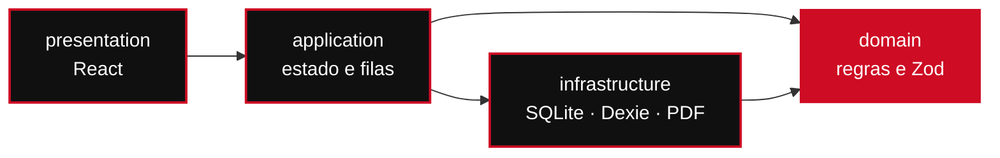
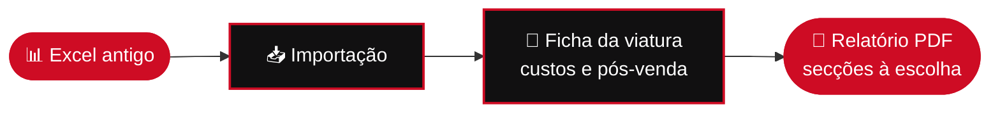

  

**[🔧 Kota](#-kota)** &nbsp;·&nbsp; **[🚗 Rasto](#-rasto)** &nbsp;·&nbsp; **[🧭 Como trabalho](#-como-trabalho)** &nbsp;·&nbsp; **[🛠️ Stack](#-stack)** &nbsp;·&nbsp; **[✉️ Contacto](#-contacto)**

 

## 🏁 Projetos

> [!NOTE]
> Oficinas e stands trabalham de luvas calçadas, com rede fraca e sem tempo para formulários. Construo ferramentas que **abrem depressa**, **guardam tudo no dispositivo** e **produzem documentos prontos a entregar ao cliente**.

<table>
  <tr>
    <td width="50%" valign="top">
      <h3>🔧 Kota</h3>
      
<b>Orçamentos de reparação em PDF</b> para oficinas, sem internet.

      

        
        
        
      

      <a href="#-kota"><b>Ver detalhes →</b></a>
    </td>
    <td width="50%" valign="top">
      <h3>🚗 Rasto</h3>
      
<b>Cada viatura, com tudo registado</b> para pequenos stands.

      

        
        
      

      <a href="#-rasto"><b>Ver detalhes →</b></a>
    </td>
  </tr>
</table>

 

---

## 🔧 Kota

> ### Orçamentos de reparação para oficinas, no telemóvel e no computador, sem internet.

O Kota cria orçamentos em **PDF A4** com totais exatos, numeração sequencial e a marca da oficina. Os dados ficam **cifrados no próprio dispositivo**: sem conta, sem nuvem, sem anúncios.

### ⚡ Do telemóvel ao cliente em poucos toques

### ✨ O que faz

| | Funcionalidade | Detalhe |
| :-: | --- | --- |
| 📴 | **100% offline** | Funciona sem rede. Orçamentos e clientes nunca saem do dispositivo. |
| 📄 | **PDF A4 profissional** | Cabeçalho com a marca da oficina, peças, mão de obra, IVA e total. |
| 📱 | **Rápido no telemóvel** | Pensado para usar junto da viatura, com envio por WhatsApp em poucos toques. |
| 🔐 | **Dados cifrados** | SQLCipher com chave no Android Keystore; DPAPI no Windows; cópias `.kota` em AES-256-GCM. |
| 🖥️ | **Android e Windows** | A mesma aplicação em todos os dispositivos. |
| 🎟️ | **Licença anual** | MB WAY, Multibanco ou cartão. Sem renovação automática. |

### 📊 Em números

| 🧪 Cobertura de testes | 📐 Viewports testados | 🔒 Cifra das cópias | 🎁 Experiência gratuita |
| :-: | :-: | :-: | :-: |
| **≥ 95%** de linhas | **390 px** e **1440 px** | **AES-256-GCM** | **7 dias**, por pedido |

### 🧱 Engenharia

<b>Aritmética financeira exata</b>

 

Montantes em **cêntimos inteiros**, quantidades em centésimos, percentagens em pontos-base, cálculos intermédios em `BigInt` com arredondamento *half-up*. Os totais são sempre **derivados**, nunca importados.

<b>Camadas puras</b>

 

O domínio não conhece React, bases de dados nem PDF. Os efeitos secundários vivem isolados na infraestrutura.

<b>Persistência transacional</b>

 

Contadores sequenciais atómicos e relógio de revisões (*CAS*) que impede sobrescrever versões mais recentes.

<b>Privacidade por desenho</b>

 

Sem telemetria nem análise de tráfego. A única ligação à rede é o licenciamento, só após um clique explícito do utilizador, e **nunca** envia dados de clientes ou orçamentos.

<b>Portão de qualidade antes de cada commit</b>

 

- [x] Testes unitários com cobertura de linhas ≥ 95%
- [x] Build estrito
- [x] Suite E2E em Playwright (390 px e 1440 px, teclado e movimento reduzido)
- [x] Verificação visual dos PDFs
- [x] Auditoria de dependências

### 📥 Descarregar e instalar

Cada versão inclui o instalador para todos os dispositivos na [**página de versões**](https://github.com/Francisss9/Portfolio/releases?q=kota).

| | Plataforma | Ficheiro | Como instalar |
| :-: | --- | --- | --- |
| 🤖 | **Android 10+** | `Kota-X.Y.Z.apk` | Descarregue, permita fontes desconhecidas quando o Android perguntar e toque em **Instalar**. Se já tem o Kota, instala-se por cima e os dados mantêm-se. |
| 🪟 | **Windows (x64, portátil)** | `Kota-X.Y.Z-x64.exe` | Sem instalação: guarde numa pasta e abra. |

> [!TIP]
> Cada versão traz um `SHA256SUMS` para confirmar a integridade do ficheiro.

> [!IMPORTANT]
> Para emitir PDF é necessária uma licença, ativada em **Definições → Licença**. Há uma experiência gratuita de 7 dias, por pedido.

 

---

## 🚗 Rasto

> ### Cada viatura, com tudo registado.

Gestão para pequenos stands: viaturas, custos, pós-venda, importação de Excel e relatórios PDF com as secções que escolher. Funciona em **modo local** ou como **piloto online**.

### 🔄 Do Excel ao relatório

### ✨ O que faz

| | Funcionalidade | Detalhe |
| :-: | --- | --- |
| 🗂️ | **Ficha completa por viatura** | Com custos e histórico de pós-venda. |
| 📥 | **Importação de Excel** | Passe do ficheiro antigo ao sistema sem reescrever nada. |
| 📄 | **Relatórios PDF** | Secções selecionáveis, prontos a partilhar. |
| 🔑 | **Acesso controlado** | O piloto online só admite contas autorizadas pelo responsável do stand. |

 

---

## 🧭 Como trabalho

| | Princípio | Na prática |
| :-: | --- | --- |
| 🎯 | **Primeiro o problema real** | Falo com quem usa a ferramenta e desenho à volta do dia a dia: uma mão ocupada, rede instável, o cliente à espera. |
| 🛡️ | **Os dados são do utilizador** | Offline por defeito, cifrado, sem contas desnecessárias. |
| 🧮 | **Rigor onde o dinheiro passa** | Aritmética inteira, testes sobre cada regra de cálculo, PDFs verificados contra a especificação. |
| 📝 | **Documentar as decisões** | Arquitetura, segurança e design ficam escritos, para que o projeto continue a fazer sentido daqui a um ano. |

 

---

## 🛠️ Stack

**Aplicação** 
    

**Plataformas** 
 

**Dados e cloud** 
  

**Qualidade** 
 

 

---

## ✉️ Contacto

Dúvidas, suporte ou pedido da aplicação:

 

Feito no Porto 🇵🇹 · Os instaladores e o `SHA256SUMS` de cada versão estão na <a href="https://github.com/Francisss9/Portfolio/releases">página de versões</a>.

