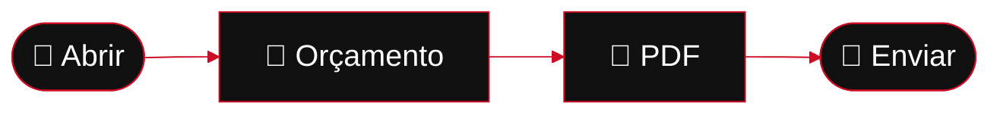
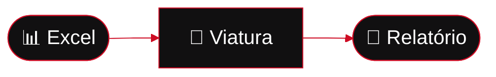

 

**Produtos próprios, feitos de ponta a ponta. Sem complicar.**

 

 

 

**[🔧 Kota](#-kota)** &nbsp;·&nbsp; **[🚗 Rasto](#-rasto)** &nbsp;·&nbsp; **[🧭 Como trabalho](#-como-trabalho)** &nbsp;·&nbsp; **[❓ FAQ](#-perguntas-frequentes)** &nbsp;·&nbsp; **[🛠️ Stack](#%EF%B8%8F-stack)** &nbsp;·&nbsp; **[✉️ Contacto](#%EF%B8%8F-contacto)**

 

## 🏁 Projetos

> [!NOTE]
> Quem trabalha com as mãos ocupadas não tem tempo para formulários. Faço software que **abre depressa**, **funciona sem rede** e **entrega o documento pronto** ao cliente.

<table>
  <tr>
    <td width="50%" valign="top">
      <h3>🔧 Kota</h3>
      
<b>O orçamento na mão do cliente, em poucos toques.</b>

      

        
        
        
      

      <a href="#-kota"><b>Ver o Kota →</b></a>
    </td>
    <td width="50%" valign="top">
      <h3>🚗 Rasto</h3>
      
<b>Cada viatura, com tudo registado.</b>

      

        
        
      

      <a href="#-rasto"><b>Ver o Rasto →</b></a>
    </td>
  </tr>
</table>

 

---

## 🔧 Kota

> ### Orçamentos de reparação para oficinas. No telemóvel, no computador, sem internet.

O Kota cria orçamentos em **PDF A4** com a marca da oficina e totais sempre certos. Tudo fica **no teu dispositivo**: sem conta, sem nuvem, sem anúncios.

 

<table>
  <tr>
    <td align="center" width="25%"><h3>📴</h3><b>Sem internet</b> Funciona em qualquer oficina</td>
    <td align="center" width="25%"><h3>⚡</h3><b>Rápido</b> Orçamento em poucos toques</td>
    <td align="center" width="25%"><h3>🔐</h3><b>Privado</b> Dados cifrados no dispositivo</td>
    <td align="center" width="25%"><h3>💬</h3><b>WhatsApp</b> Do PDF ao cliente num toque</td>
  </tr>
</table>

 

<b>✨ Tudo o que o Kota faz</b>

 

| | | |
| :-: | --- | --- |
| 📴 | **100% offline** | Orçamentos e clientes nunca saem do dispositivo. |
| 📄 | **PDF A4 profissional** | Marca da oficina, peças, mão de obra, IVA e total. |
| 📱 | **Pensado para o telemóvel** | Para usar junto da viatura. |
| 🔐 | **Dados cifrados** | Protegidos no teu dispositivo. |
| 🖥️ | **Android e Windows** | A mesma aplicação em todo o lado. |
| 🎟️ | **Licença anual** | MB WAY, Multibanco ou cartão. Sem renovação automática. |

<b>🧠 Por baixo do capô</b>

 

- 🧮 **Contas sempre certas.** Nem um cêntimo fora do sítio.
- 🔒 **Zero rastreio.** Sem telemetria, anúncios nem espiões.
- 🧪 **Testado até à exaustão** em telemóvel e computador, antes de cada versão.

| 🧪 Testes | 📱 Dispositivos | 🔒 Segurança | 🎁 Experiência |
| :-: | :-: | :-: | :-: |
| **≥ 95%** do código testado | **Android** e **Windows** | **Cifrado** no dispositivo | **7 dias** grátis |

<b>📥 Descarregar e instalar</b>

 

Cada versão está na [**página de versões**](https://github.com/Francisss9/Portfolio/releases?q=kota).

| | Plataforma | Ficheiro | Como instalar |
| :-: | --- | --- | --- |
| 🤖 | **Android 10+** | `.apk` | Descarrega, permite fontes desconhecidas quando o Android perguntar e toca em **Instalar**. Se já tens o Kota, os teus dados mantêm-se. |
| 🪟 | **Windows (portátil)** | `.exe` | Sem instalação: guarda numa pasta e abre. |

> [!TIP]
> Cada versão vem com um ficheiro de verificação para confirmares que o download está intacto.

> [!IMPORTANT]
> Para emitir PDF precisas de uma licença (**Definições → Licença**). Há 7 dias grátis para experimentares.

 

---

## 🚗 Rasto

> ### Cada viatura, com tudo registado.

Gestão para pequenos stands: viaturas, custos, pós-venda, importação de Excel e relatórios PDF com as secções que escolheres. Em **modo local** ou como **piloto online**.

 

<table>
  <tr>
    <td align="center" width="25%"><h3>🗂️</h3><b>Ficha da viatura</b> Custos e pós-venda num só sítio</td>
    <td align="center" width="25%"><h3>📥</h3><b>Importa o Excel</b> Sem reescrever nada</td>
    <td align="center" width="25%"><h3>📄</h3><b>Relatórios PDF</b> Com as secções que escolheres</td>
    <td align="center" width="25%"><h3>🔑</h3><b>Acesso controlado</b> Só entra quem o dono autorizar</td>
  </tr>
</table>

 

 

---

## ❓ Perguntas frequentes

<b>Preciso de internet para usar o Kota?</b>

 

Não. O Kota funciona sem rede. A única ligação à internet é para ativar a licença, e só depois de clicares para a ativar.

<b>Onde ficam os meus dados?</b>

 

No teu dispositivo, cifrados. Orçamentos e clientes nunca saem de lá, e não há contas nem nuvem.

<b>Quanto custa e como se paga?</b>

 

O Kota tem licença anual, paga por MB WAY, Multibanco ou cartão, sem renovação automática. Podes experimentar 7 dias grátis, por pedido.

<b>Em que dispositivos funciona o Kota?</b>

 

Android 10 ou superior e Windows (versão portátil, sem instalação).

<b>O Rasto aceita o meu Excel antigo?</b>

 

Sim. Importas o ficheiro e passas ao sistema sem reescrever nada.

<b>Quem pode entrar no Rasto?</b>

 

Só quem o dono do stand autorizar.

 

---

## 🧭 Como trabalho

| | | |
| :-: | --- | --- |
| 🎯 | **Primeiro o problema real** | Falo com quem usa e desenho à volta do dia a dia: mãos ocupadas, rede fraca, cliente à espera. |
| 🛡️ | **Os dados são de quem os cria** | Offline por defeito, cifrado, sem contas desnecessárias. |
| 🧮 | **Rigor onde o dinheiro passa** | Os totais batem sempre certo e cada regra de cálculo é testada. |
| 📝 | **Tudo escrito** | Para o projeto fazer sentido daqui a um ano. |

 

---

## 🛠️ Stack

Também: Zod · Capacitor · Vitest

 

---

## ☁️ O que faço

### Faço **SaaS**.

*Software como serviço, feito para negócios reais.*

| | | |
| :-: | --- | --- |
| 🛠️ | **Produto próprio** | Desenho, construo e mantenho cada produto de ponta a ponta. |
| 🔄 | **Sempre a evoluir** | Cada versão traz melhorias, com o feedback de quem usa. |
| 🎟️ | **Licença simples** | Pagas pelo que usas, sem letras pequenas. |

 

---

## ✉️ Contacto

### Tens um negócio e uma dor de cabeça?
**Fala comigo.** Respondo depressa.

 

Feito no Porto 🇵🇹 · Todas as versões estão na <a href="https://github.com/Francisss9/Portfolio/releases">página de versões</a>.

